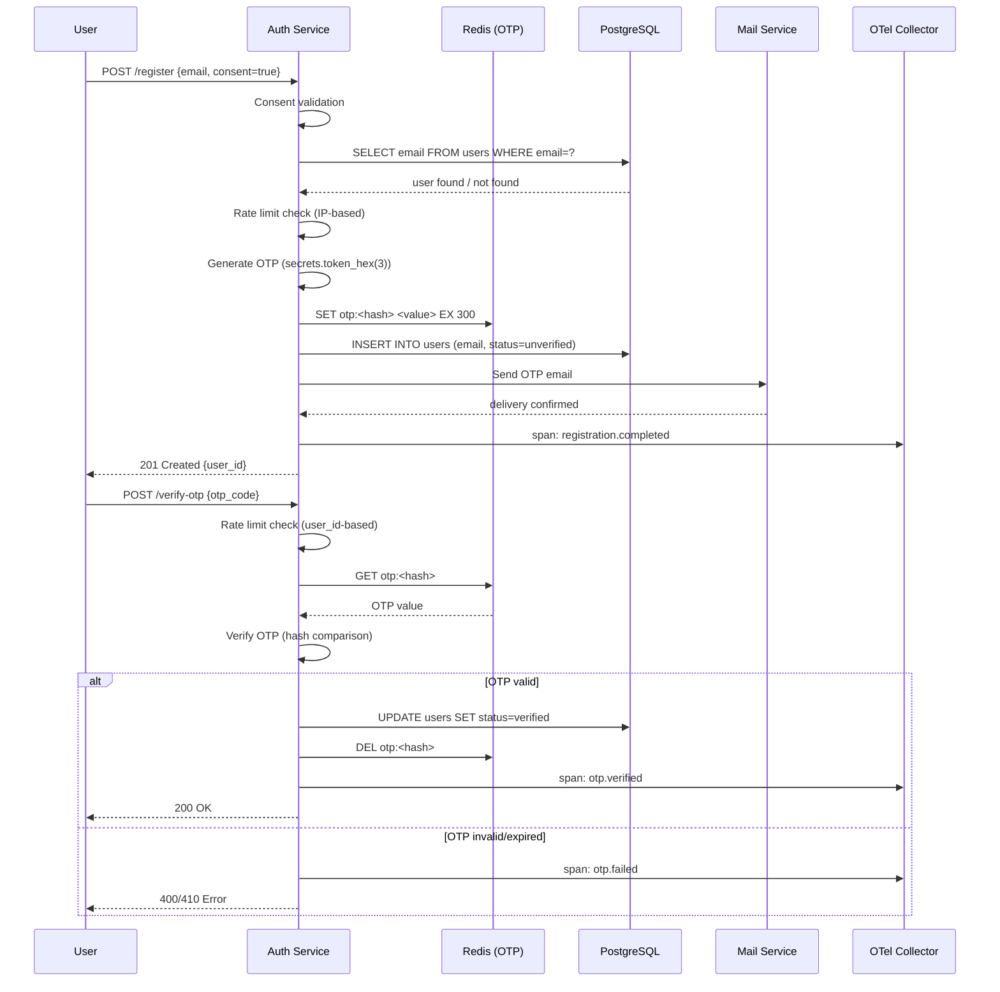

# Design: User Registration with OTP

## Context
Фича добавляет email-based регистрацию с OTP-верификацией в существующую auth-систему.
Система использует PostgreSQL для хранения пользователей, Redis для OTP-токенов и rate-limiting,
mail-service для доставки OTP. Существующая инструментация: otel-sdk-python.

## Goals / Non-Goals

**Goals:**
- Email-based регистрация с OTP-верификацией (6-значный код, TTL 5 мин)
- Rate-limit: 3 запроса/мин на `/register`, 10 попыток/час на `/verify-otp`
- Consent-проверка (обязательное согласие на обработку ПДн по 152-ФЗ/GDPR)
- PII redaction в телеметрии (email маскируется до экспорта)
- RED-метрики и structured logs для observability

**Non-Goals:**
- Social login (Google, GitHub, Yandex)
- MFA / 2FA для авторизованных пользователей
- Password recovery / reset
- Email template design и content
- A/B-тестирование UX OTP-формы

## Decisions

### Компонентная архитектура

```
┌─────────────┐     ┌──────────────────┐     ┌─────────────┐
│   Client     │────▶│  Auth Service    │────▶│ PostgreSQL  │
│   (Web/Mobile)│    │  (FastAPI)       │     │  (users)    │
└─────────────┘     │                  │     └─────────────┘
                    │  - Registration  │
                    │  - OTP verify    │     ┌─────────────┐
                    │  - Rate-limit    │────▶│   Redis     │
                    │  - Consent check │     │  (OTPs)     │
                    └──────────────────┘     └─────────────┘
                            │
                            │ mail-service
                            ▼
                    ┌──────────────────┐
                    │   Mail Service   │
                    │  (OTP email)     │
                    └──────────────────┘
                            │
                            │ OTel SDK
                            ▼
                    ┌──────────────────┐
                    │  OTel Collector  │────▶ Prometheus / Loki / Jaeger
                    └──────────────────┘
```

### Потоки данных



### Технологический стек

| Слой | Технология | Обоснование |
|---|---|---|
| API | FastAPI (Python 3.11) | Existing instrumentation: otel-sdk-python, async support |
| Database | PostgreSQL 15 | Existing, ACID для пользователей |
| Cache / OTP store | Redis 7 | TTL support, atomic operations, low latency |
| Rate limiting | Redis-based sliding window | Distributed, accurate, existing infra |
| Mail delivery | Existing mail-service | Reuse, SMTP/SES integration |
| Tracing | OpenTelemetry SDK (auto) | otel-sdk-python уже в проекте |
| Metrics | Prometheus | Existing infra |
| Logs | Structured JSON → Loki | Existing infra |
| Visualization | Grafana | Existing infra |

### Точки инструментирования

> Заполняется на основе Observability Contract из spec.md.

| Сигнал | Где создаётся (файл/класс) | Тип | Auto/Manual | Атрибуты |
|--------|---------------------------|-----|-------------|----------|
| `http.server.request.duration` | OTel auto-instrumentation (FastAPI middleware) | metric | auto | `http.method`, `http.route`, `http.status_code`, `trace_id` |
| `http.server.requests` | OTel auto-instrumentation | metric | auto | `http.method`, `http.route`, `http.status_code` |
| `registration.completed` | `RegistrationService.create()` | metric (counter) | manual | `user.tenant_id`, `trace_id` |
| `registration.otp.sent` | `OtpService.generate()` | metric (counter) | manual | `channel=email`, `trace_id` |
| `registration.otp.verified` | `OtpService.verify()` | metric (counter) | manual | `trace_id` |
| `registration.otp.failed` | `OtpService.verify()` | metric (counter) | manual | `reason`, `trace_id` |
| `security.rate_limit.triggered` | `RateLimitMiddleware` | log (structured) | manual | `endpoint`, `limit_type`, `trace_id` |
| `security.pii.redacted` | `PiiRedactionMiddleware` | log (audit) | manual | `field.name`, `original_length`, `trace_id` |
| `otp.generate` | `OtpService.generate()` | span (manual) | manual | `otp.ttl_seconds=300`, `trace_id` |
| `otp.verify` | `OtpService.verify()` | span (manual) | manual | `otp.success`, `otp.reason`, `trace_id` |
| `email.send` | `MailClient.send_otp()` | span (manual) | manual | `email.template="otp"`, `trace_id` |

### Проброс корреляции

- **W3C `traceparent`:**
  - FastAPI middleware извлекает `traceparent` из входящего HTTP-запроса
  - Если отсутствует — создаётся новый через `TraceProvider.get_tracer().start_span()`
  - Передаётся во все исходящие вызовы (Redis, PostgreSQL, mail-service) через HTTP headers / OTel propagators

- **`X-Request-ID`:**
  - Генерируется UUID v4 в middleware, если отсутствует во входящем запросе
  - Добавляется ко всем лог-записям через structlog context
  - Передаётся в mail-service как header `X-Request-ID`

- **Auth Service → Mail Service:**
  - `traceparent` передаётся через HTTP header `Trace-Context`
  - Mail-service должен поддерживать W3C Trace Context (ADR-кандидат)

- **OTel → Backend:**
  - Prometheus: metrics с `trace_id` как label (для correlation с logs)
  - Loki: structured JSON logs с `trace_id` полем
  - Jaeger: spans с `trace_id` из W3C Trace Context

## Risks / Trade-offs

- **Риск:** Redis downtime → OTP не сохраняется → регистрация не возможна
  **Митигация:** Redis cluster mode + fallback to PostgreSQL (slower, но functional)

- **Риск:** Email delivery delay → пользователь думает, что OTP не дошёл
  **Митигация:** UI показывает "OTP отправлен, проверьте почту" + кнопка "Отправить повторно" через 60 сек

- **Trade-off:** OTP в Redis vs PostgreSQL
  **Митигация:** Redis выбран из-за native TTL и atomic operations; PostgreSQL не поддерживает TTL без cron

- **Trade-off:** Rate-limit по IP vs по email
  **Митигация:** Dual approach: IP-based для `/register`, email-based для `/verify-otp`

- **Trade-off:** PII redaction на уровне middleware vs на уровне каждого сервиса
  **Митигация:** Middleware-подход (единая точка контроля, проще тестировать); ADR-кандидат

## Migration Plan
1. **Phase 1:** Развернуть Redis-кластер для OTP + rate-limiting
2. **Phase 2:** Реализовать `/register` endpoint (без OTP, для обратной совместимости)
3. **Phase 3:** Добавить OTP-генерацию и email-доставку
4. **Phase 4:** Добавить `/verify-otp` endpoint
5. **Phase 5:** Включить rate-limiting и PII redaction
6. **Phase 6:** Canary deployment 5% → 50% → 100%

## Open Questions
- [ ] Mail-service поддерживает W3C Trace Context для корреляции?
- [ ] Redis-кластер: dedicated instance или shared с другими сервисами?
- [ ] Нужно ли поддерживать resend OTP через SMS как fallback?
- [ ] TTL OTP: 5 минут — достаточно для UX, или сократить до 3 минут для security?
