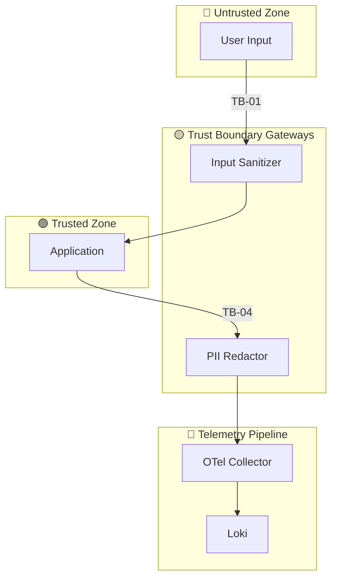

# M5: Threat Model

## Выбор методологии
Методология выбирается на основе `security_context`, а не по умолчанию.

| Методология | Когда выбирать | Сигналы в `security_context` |
|-------------|----------------|------------------------------|
| **STRIDE** | Классические системы, API без AI | `ai: []`; регуляторика общего профиля |
| **OWASP Top 10 for LLM** | Есть LLM/AI-компоненты | `ai: ["RAG", "agent", …]` |
| **LINDDUN** | Приватность — ключевое требование | `regulatory` содержит GDPR / 152-ФЗ / CCPA; `assets` содержит PII |
| **PASTA / OCTAVE** | Крупные риск-ориентированные инициативы | Явное требование risk-assessment; enterprise-контекст |
| **MITRE ATT&CK** | Защита от целенаправленных атак | Указание на APT / adversarial-модель |
| **STRIDE + OWASP LLM** | Гибридные системы: LLM внутри классической архитектуры | `ai` непусто **и** есть auth/integrations/PII |
| **Baseline** | Внутренняя фича без чувствительных данных | `security_context: {"baseline": true}` |

**Правила выбора:**
1. `ai` непусто + PII/регуляторика → **STRIDE + OWASP LLM**
2. `ai` непусто, PII нет → **OWASP Top 10 for LLM**
3. `ai` пусто, но `regulatory` содержит приватность → **LINDDUN** (+ STRIDE при auth)
4. `ai` пусто, приватность не ключевая → **STRIDE**
5. Равноправны → **остановить pipeline**, запросить выбор (2–3 варианта)
6. `baseline` — только при явном подтверждении отсутствия чувствительных данных

> Выбранная методология **фиксируется в артефакте и context.md**.
> Изменение на следующих шагах запрещено без повторного прогона `threat-model`.

---

## Структура threat-model.md

```markdown
## 1. Выбор методологии
- **Выбрано:** <STRIDE | OWASP LLM | LINDDUN | STRIDE+OWASP LLM | …>
- **Обоснование:** [почему именно эта методология, со ссылкой на security_context]
- **Отвергнутые альтернативы:** [методология — причина]
- **Скоуп:** [какие компоненты/потоки покрыты]

## 2. Активы и классификация данных
| Актив | Класс данных | Компонент | Владелец |
|---|---|---|---|
| User email | PII | PostgreSQL, Redis | auth-team |
| Telemetry (logs/traces) | mixed | OTel Collector → backends | platform-team |

## 3. Границы доверия (Trust Boundaries)
| ID | Граница | Откуда → Куда | Контроль безопасности |
|----|---------|---------------|----------------------|
| TB-01 | User → Input Sanitizer | untrusted → trusted | sanitizer + rate-limit |
| TB-04 | App → Telemetry pipeline | trusted → trusted | redaction + PII filter |

## 4. Визуализация потоков данных
**Легенда:**
- 🟢 **Trusted** — компоненты под нашим контролем
- 🔴 **Untrusted** — внешние источники ввода
- 🟡 **Boundary / Gateway** — точки пересечения границ
- 🔵 **Telemetry** — поток телеметрии (отдельный актив)



## 5. Матрица угроз с Risk Scoring
> Risk = Likelihood (1–5) × Impact (1–5). Max = 25.
> **Top-3** — угрозы с наивысшим Risk для immediate mitigation.

| ID | Категория | Угроза | Вектор | Актив | TB | L | I | Risk | Контроль | Requirement |
|----|-----------|--------|--------|-------|----|---|---|------|----------|-------------|
| TM-01 | STRIDE-T | OTP brute-force | `/verify-otp` | OTP tokens | TB-01 | 5 | 3 | **15** | Rate-limit + lock | NFR-SEC-001 |
| TM-02 | STRIDE-I | PII leak в телеметрию | log/span | Email в логах | TB-04 | 4 | 3 | **12** | Redaction middleware | NFR-SEC-002 |
| TM-03 | STRIDE-T | Email enumeration | `/register` timing | User database | TB-01 | 3 | 3 | **9** | Timing mask | NFR-SEC-003 |

### Top-3 для immediate mitigation
1. **TM-01 (Risk 15)** — OTP brute-force → NFR-SEC-001, P0
2. **TM-02 (Risk 12)** — PII leak в телеметрию → NFR-SEC-002, P0
3. **TM-03 (Risk 9)** — Email enumeration → NFR-SEC-003, P1

## 6. Требования безопасности (→ spec.md)
| Requirement | Описание | Покрывает TM | Метрика / verify |
|-------------|----------|--------------|------------------|
| NFR-SEC-001 | Rate-limit OTP: 10 attempts/hour | TM-01 | `registration.otp.failed{reason="rate_limit"}` |
| NFR-SEC-002 | PII redaction в логах/спанах | TM-02 | 0 PII в логах; тест TC-SEC-002 |

## 7. Влияние на ADR
- ADR-кандидат: выбор стратегии rate-limiting — NFR-SEC-001
- ADR-кандидат: выбор стратегии PII redaction — NFR-SEC-002

## 8. Влияние на наблюдаемость
| Сигнал | Изменение по итогам TM | Связанный TM |
|--------|------------------------|--------------|
| `security.pii.redacted` | добавлен как audit-log | TM-02 |
| все логи | PII redaction middleware | TM-02 |
```
